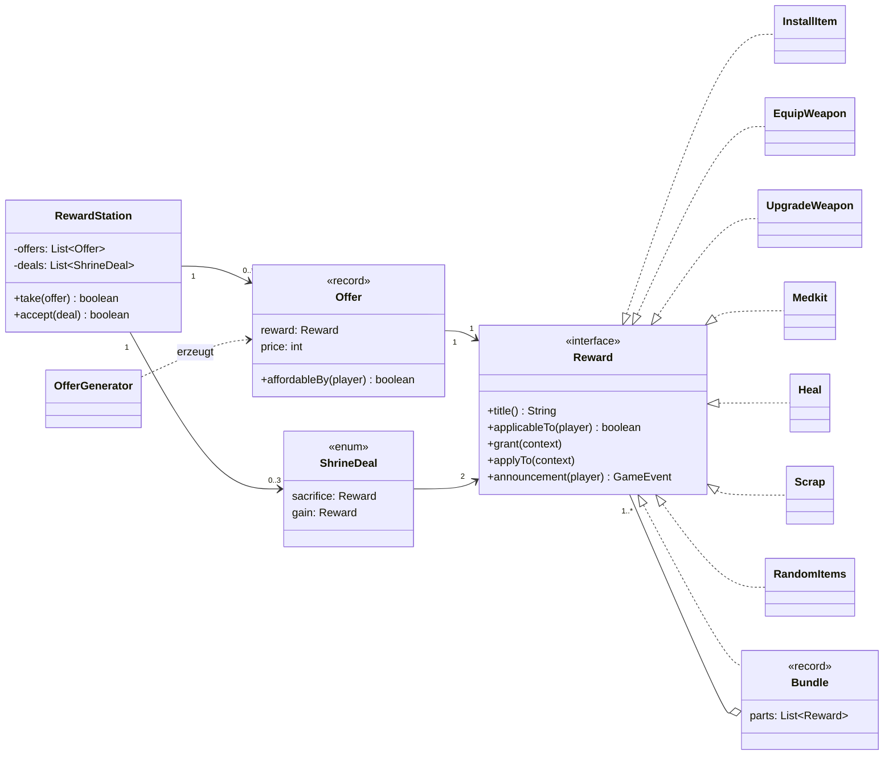
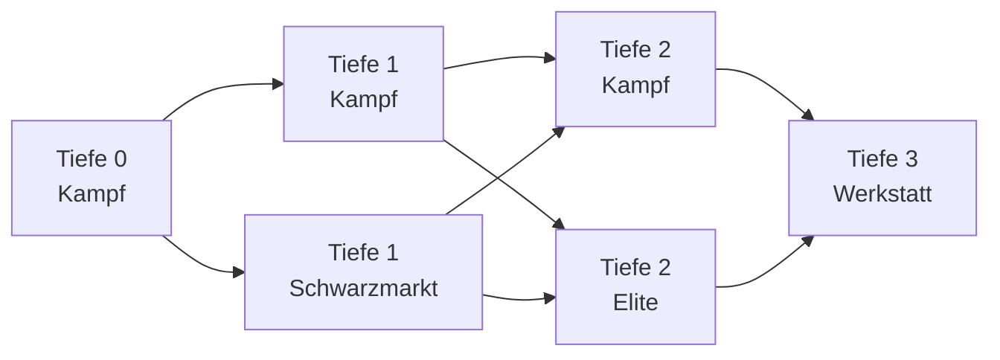

# Entwurf: Belohnungen objektorientiert

Stand 27.10.2026, nach dem Feedback zur SWEN1-Unterrichtsaufgabe LE07 (Use-Case-Realisierung). Dieses Dokument klärt zuerst Begriffe und Verantwortlichkeiten und vergleicht dann Varianten. Code ist noch keiner geändert.

## 1 Ausgangslage

Zum Feedback in eigenen Worten:

- Darstellung und Vorgehen in LE07 waren in Ordnung.
- Die nächste Priorität ist die **objektorientierte Spiellogik**. Konkret geht es darum, was `Rewards` und `Offer` fachlich bedeuten und wofür sie verantwortlich sind.
- Angeregt wurden drei Ideen:
  - ein Singular `Reward`
  - dass ein Angebot seine Wirkung selbst anwendet (`apply`)
  - Composite für kombinierte Wirkungen
- Als weitere Option kam eine vorab modellierte Raumwelt mit Nachfolgerlisten dazu.
- Checkpoints sind in Ordnung. Persistenz hat für dieses Ziel keine Priorität.
- Die Diagramme im Bericht müssen ohne Zoom lesbar sein.

Das alles sind Entwurfsvorschläge, keine Pflichten. Wir entscheiden begründet.

## 2 Was die Klassen heute tun

| Klasse | Was sie fachlich ist | Was sie im Code tut |
|---|---|---|
| `Offer` | ein Angebot: eine Belohnung zu einem Preis | Record mit `Type`-Enum, zwei Feldern, von denen je nach Art eines `null` ist (`item`, `weapon`), und Preis. `title()` und `effect()` verzweigen per `switch` über die Art. |
| `Rewards` (Plural) | die Auslage des gesicherten Raums: Beutekapsel, Schwarzmarkt, Werkstatt oder Schrein | Macht drei verschiedene Dinge: **(1)** Angebote würfeln (Seltenheit, Gewichte, Entfesselung, Grenzbrecher, Preise), **(2)** Zustand und Abrechnung des Raums (ausgelegt, schon genommen, Preis, Schrott), **(3)** die Wirkung jedes Angebots anwenden, als `switch` über `Offer.Type` in `apply`. |
| `ShrineDeal` | ein Handel: ein Opfer gegen eine Belohnung | Enum, das nur Texte hält. Die Auszahlung ist ein `switch` in `Rewards.accept`. Das Javadoc verweist noch auf `GameRun`. |
| `GameRun.rollLevelOffers` | Auswahl beim Levelaufstieg | würfelt Angebote mit den Hilfen von `Rewards`, also am falschen Ort |

**Probleme, nach GRASP benannt**

- **Information Expert verletzt:** Das Angebot kennt seine Wirkung nicht. `Rewards` muss die Art abfragen, um zu wissen, was zu tun ist.
- **Polymorphism fehlt:** Dieselbe Fallunterscheidung über `Offer.Type` steht in `title`, `effect`, `apply` und an mehreren Stellen in der UI. Eine neue Belohnungsart bedeutet Änderungen an allen diesen Stellen.
- **Low Cohesion:** `Rewards` vereint Würfeln, Abrechnen und Anwenden. Der Plural im Namen sagt nicht, welches davon gemeint ist.
- **Doppelte Logik:** „Medkit +1, gedeckelt“ und „heilen“ sind in `apply`, in `accept` (Schrein) und bei den Vorräten jeweils eigens programmiert.

## 3 Begriffe nach der Klärung

| Begriff | Klasse | Bedeutung | Kardinalität |
|---|---|---|---|
| **Belohnung** | `Reward` (Singular) | **eine** Wirkung auf die Figur: Modul installieren, Waffe ausrüsten, Waffe verbessern, Medkit, Heilung, Schrott … | – |
| **Bündel** | `Reward.Bundle` | mehrere Belohnungen, die als eine wirken, z. B. Vorräte = Heilung + Energie + Schrott + Medkit | 1 Bündel → 1..* Belohnungen |
| **Angebot** | `Offer` | eine Belohnung **zu einem Preis** (Beutekapsel und Levelaufstieg: Preis 0) | 1 Angebot → genau 1 Belohnung |
| **Handel** | `ShrineDeal` | ein **Opfer** gegen eine **Belohnung** | 1 Handel → 1 Opfer, 1 Belohnung |
| **Station** | `RewardStation` (bisher `Rewards`) | was im gesicherten Raum ausliegt, und ob schon gewählt wurde | 1 Station → 0..* Angebote, 0..3 Handel |
| **Angebotswurf** | `OfferGenerator` (neu) | würfelt reproduzierbar, was ausliegt, auch beim Levelaufstieg | – |

Die Begriffe stimmen mit dem [Glossar](GLOSSAR.md) überein, also Beute, Schwarzmarkt, Werkstatt, Schrein und Opfer. Der Singular `Reward` passt, sobald er **eine Wirkung** bezeichnet. Den Plural `Rewards` einfach in `Reward` umzubenennen wäre dagegen falsch, weil die heutige Klasse die Auslage ist und nicht eine Belohnung.

## 4 Varianten

**A · `Offer.apply(…)` mit Unterklassen von `Offer`**
`Offer` wird abstrakt, und jede Angebotsart (Modul, Waffe, Medkit …) setzt `apply` selbst um.

- **Vorteile:** wenig Klassen, und Information Expert ist erfüllt.
- **Nachteile:**
  - Preis und Wirkung bleiben in einer Klasse.
  - Schrein-Handel und Vorräte, die mehrere Wirkungen kombinieren, passen nicht hinein und bleiben doppelt.

**B · Eigene Abstraktion `Reward` mit Composite (gewählt)**
`Offer` besteht aus `Reward` und Preis. `Reward` ist ein Interface, das jede Wirkung selbst umsetzt. `Bundle` fasst mehrere Belohnungen zu einer zusammen. `ShrineDeal` besteht aus Opfer und Belohnung.

- **Vorteile:**
  - Jede Klasse hat genau eine fachliche Aufgabe.
  - Eine neue Belohnung ist eine neue Klasse; Station, Angebot und UI-Logik bleiben unverändert (Protected Variations).
  - Vorräte, Schrein und Levelaufstieg nutzen dieselben Bausteine.
- **Nachteile:**
  - mehr kleine Klassen
  - Die UI unterscheidet für Symbol und Farbe weiterhin die Art. Das ist reine Darstellung und gehört deshalb dorthin.

**C · Nur umbenennen, `switch` behalten**

- **Vorteil:** sehr wenig Aufwand.
- **Nachteil:** löst kein Problem aus Abschnitt 2. Verworfen.

Composite setzen wir nur ein, weil die Domäne es verlangt: Vorräte und Schrein-Handel **sind** Gruppen von Wirkungen, die genauso angewendet werden wie eine einzelne. Eine Methode `apply` allein wäre noch kein Composite.

## 5 Gewählter Entwurf

**Wer prüft was** (bewusst getrennt):

| Frage | zuständig | Begründung |
|---|---|---|
| Liegt das Angebot hier aus? Richtige Phase? Schon gewählt? | `RewardStation` | Sie kennt die Auslage des Raums (Information Expert). |
| Reicht der Schrott, und wird er abgebucht? | `Offer` | Es kennt seinen Preis. |
| Bewirkt die Belohnung etwas (z. B. Leben nicht voll, Modul nicht ausgereizt)? Wirkung anwenden und melden. | `Reward` | Es kennt seine Wirkung (Polymorphism). |

**Ablauf `take(offer)`:**
1. Station: liegt aus, Phase stimmt
2. Offer: bezahlbar, und die Belohnung bewirkt etwas
3. `reward.grant(context)`
4. Schrott abbuchen
5. Station: Auslage nachführen

`grant` ist eine **Schablonenmethode**: zuerst `applyTo`, dann `announcement` melden.
- Ein `Bundle` wendet seine Teile still an und meldet einmal für alle.
- Ein Handel meldet sich mit seinem eigenen Titel.

Damit bleiben die Meldungen im Spiel genau wie heute.

**Kopplung:** `Reward` kennt nicht `GameRun`, sondern nur einen schmalen `Reward.Context`: die Figur, den Angebotswurf für zufällige Module und den Ereigniskanal.

**Muster:**
- GRASP: Information Expert, Polymorphism, High Cohesion, Low Coupling, Pure Fabrication (`OfferGenerator`), Protected Variations
- GoF: Composite, Schablonenmethode

## 6 Raumwelt: Entscheid

**Heute:** `RoomGenerator.room(depth, branch)` ist eine reine Funktion des Seeds.
- Räume entstehen erst beim Betreten, sind aber trotzdem reproduzierbar.
- Jeder Raum der Tiefe *d* führt zu allen 1–2 Räumen der Tiefe *d + 1*. Die Wege laufen also immer wieder zusammen; das ist ein geschichteter Graph und kein Binärbaum.
- Der Checkpoint speichert nur Seed und gewählte Abzweige.

**Alternative:** Bei Start des Tauchgangs alle Räume als Objekte mit Inhalt und einer Liste der Nachfolger erzeugen.

**Entscheid: Mischform.**
- Beim Start entsteht eine leichte **Routenkarte** mit Knoten (Tiefe, Abzweig, Raumart) und **expliziten Nachfolgerlisten**.
- Der detaillierte `RoomPlan` (Geometrie, Gegnerwellen) entsteht weiterhin erst beim Betreten.

Gründe:
- Die Nachfolgerbeziehung steht dann im Domänenmodell, statt in Indexrechnung versteckt zu sein.
- Später sind auch Wege möglich, die sich nicht überall kreuzen.
- Seed, Reproduzierbarkeit und Checkpoint bleiben unverändert.
- Detaillierte Räume vorab zu erzeugen hätte keinen fachlichen Nutzen und würde den Start verlangsamen.

**Priorität:** nach den Belohnungen.

## 7 Umsetzung in kleinen Schritten

Jeder Schritt ist einzeln lauffähig, alle Tests bleiben grün. Wo nötig, kommen Tests für das bestehende Verhalten dazu: Auswahl, Preis und Schrott, Stufengrenzen, Meldungen.

1. `Reward` mit den Blättern und `Bundle` einführen. `Offer` besteht dann aus `Reward` und Preis, die Fabrikmethoden (`Offer.item`, `Offer.weapon` …) bleiben.
2. `Rewards.apply` (der `switch`) entfällt, stattdessen `offer.reward().grant(context)`.
3. `ShrineDeal` bekommt Opfer und Belohnung, der `switch` in `accept` entfällt.
4. `Rewards` aufteilen in `RewardStation` und `OfferGenerator`. `rollLevelOffers` zieht von `GameRun` in den Generator um.
5. Domänenmodell, DCD und das LE07-Interaktionsdiagramm `take` nachführen. Die Diagramme im TB I/II bei normaler Grösse prüfen: Schrift mindestens etwa 8 pt, sonst aufteilen.
6. Später: Routenkarte mit Nachfolgerlisten (Abschnitt 6).

Unverändert bleiben die Spielregeln, Preise, Grenzen und Meldungen sowie die Speicherung.
