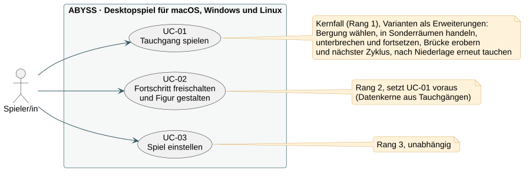
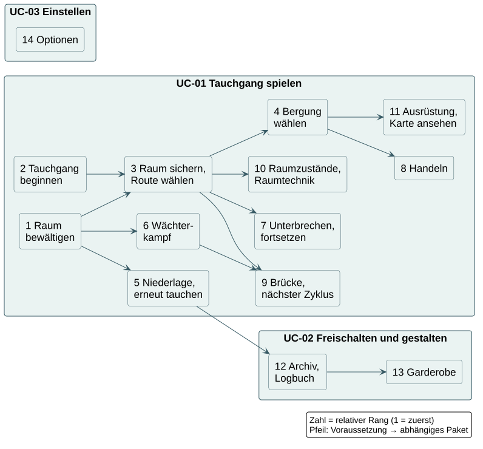
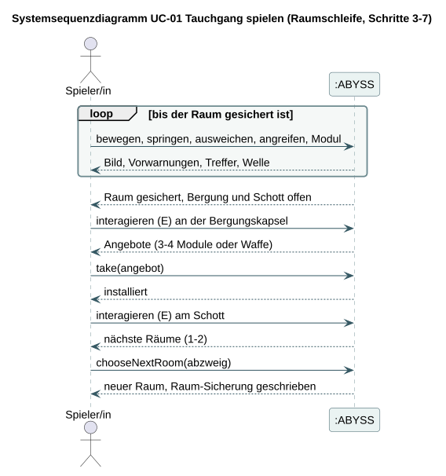
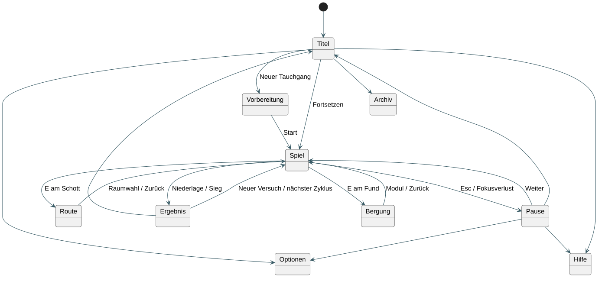
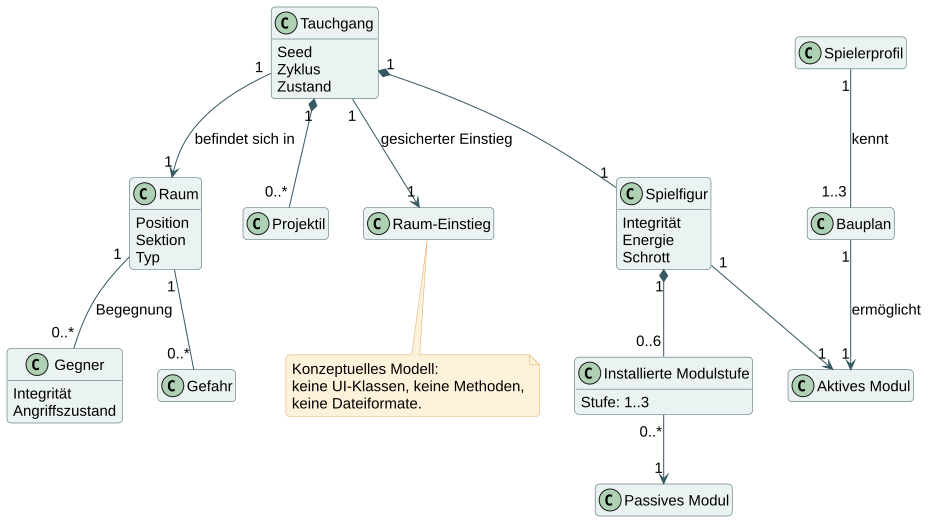
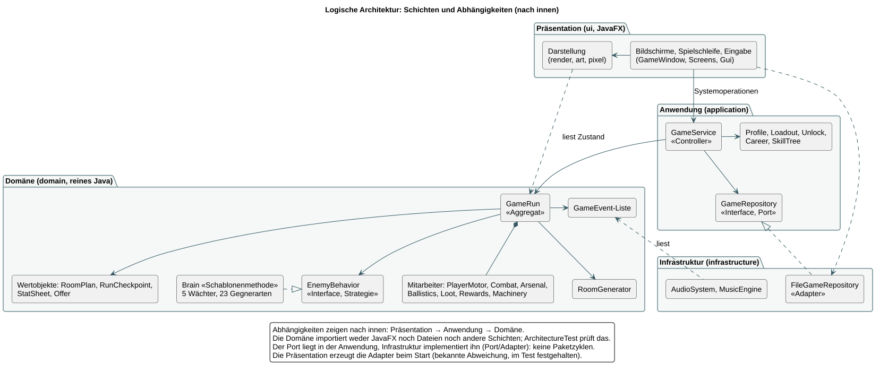
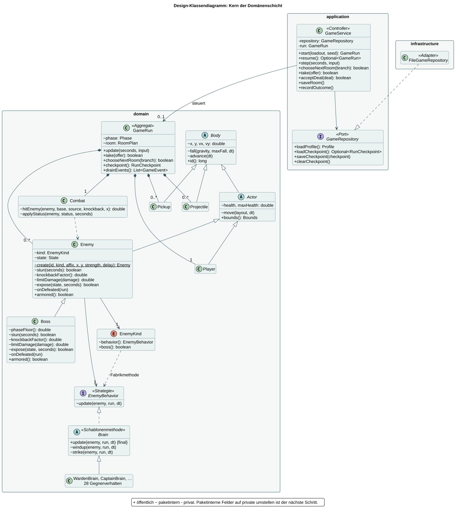
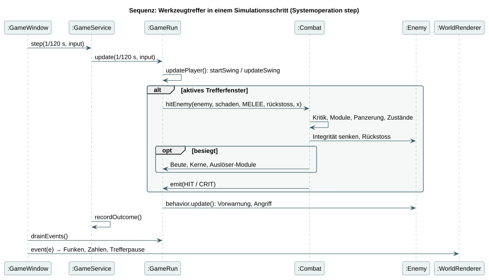
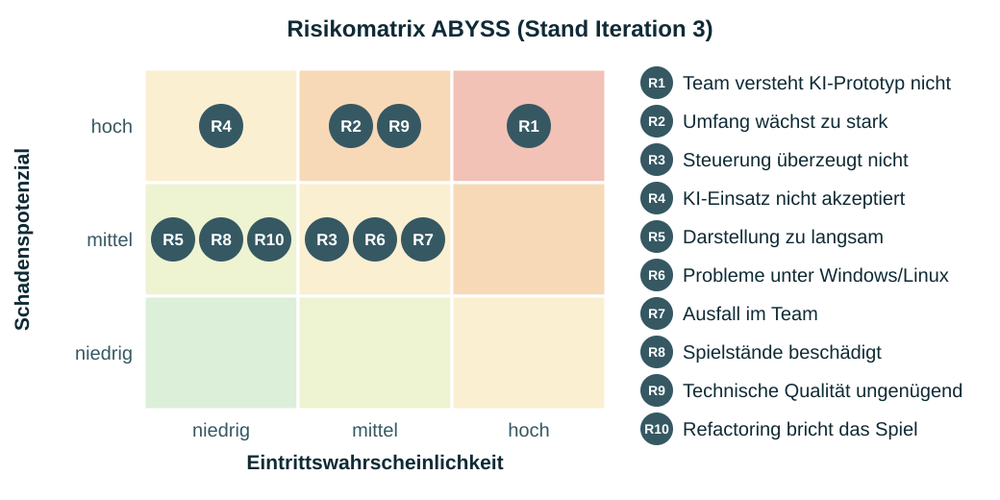

# M2 · Technischer Bericht I – Lösungsarchitektur ABYSS

*Arbeitsfassung nach dem PM3-Auftrag „Lösungsarchitektur (M2)“, Stand 25.09.2026 (Prototyp-Version 1.1), Kapitel 1, 2 und 7.3 überarbeitet am 06.10.2026 nach dem Feedback zur Projektskizze M1. Gliederung gemäss den acht Berichtskapiteln des Auftrags. Die Abgabe erfolgt als PDF in der SoE-Vorlage „Technischer Bericht I“ zusammen mit einer ZIP-Datei aus Quellcode, Konfiguration und Javadoc. Stellen mit `[TEAM]` sind durch das Team zu ergänzen.*

**Abgabeartefakte laut Auftrag und ihr Ort im Repository**

| Artefakt | Ort |
|---|---|
| Vollständiger Quellcode mit Konfiguration | Repository-Wurzel (`src`, `build.gradle`, Gradle Wrapper) |
| API-Dokumentation (HTML) | `./gradlew javadoc` → `build/docs/javadoc/index.html` |
| Technischer Bericht I (PDF) | dieses Dokument als Inhaltsbasis |
| Demonstration | lauffähige App (`./gradlew run` oder Mac-Paket) |

---

## 1 Use-Case-Modell

### 1.1 Übersicht

Abbildung 1 zeigt den Systemkontext: Die spielende Person ist der einzige Akteur. Profil und Raum-Sicherung speichert das System selbst; das lokale Dateisystem liegt innerhalb der Systemgrenze und ist deshalb kein Akteur. Kundennutzen ist Spielspass; der Kernfall UC-01 „Tauchgang spielen“ bildet ihn ab.

*Abbildung 1: Use-Case-Diagramm von ABYSS (PlantUML-Quelle: `docs/diagrams/01-use-cases.puml`).*

*Tabelle 1: Use Cases mit relativem Rang und Abhängigkeiten*

| ID | Use Case | Rang | Abhängig von | Tiefe |
|---|---|---|---|---|
| UC-01 | Tauchgang spielen | 1 (Kernfall) | – | fully dressed |
| UC-02 | Fortschritt freischalten und Figur gestalten | 2 | UC-01 (Datenkerne aus Tauchgängen) | casual |
| UC-03 | Spiel einstellen | 3 | – | brief |

Bergung, Handel, Unterbrechen und Fortsetzen, Sieg mit nächstem Zyklus und Niederlage mit erneutem Tauchen sind Varianten von UC-01 und als Erweiterungen beschrieben. Als Arbeitspakete priorisiert das Team sie relativ zueinander (Abbildung 2, Tabelle 2). Muss/Soll wird bewusst noch nicht festgelegt.

*Abbildung 2: Arbeitspakete der Use Cases mit relativem Rang und Abhängigkeiten.*

*Tabelle 2: Arbeitspakete mit Rang und Voraussetzungen*

| Rang | Arbeitspaket | Use Case | Voraussetzung |
|---|---|---|---|
| 1 | Raum bewältigen: Bewegung, Kampf, Vorwarnung | UC-01 | – |
| 2 | Tauchgang beginnen: Ausrüstung wählen, Boot erzeugen | UC-01 | – |
| 3 | Raum sichern und nächsten Raum wählen | UC-01 | 1, 2 |
| 4 | Bergung wählen | UC-01 | 3 |
| 5 | Niederlage und erneut tauchen | UC-01 | 1 |
| 6 | Wächterkampf mit Phasen | UC-01 | 1 |
| 7 | Unterbrechen und fortsetzen | UC-01 | 3 |
| 8 | In Sonderräumen handeln | UC-01 | 4 |
| 9 | Brücke erobern, nächster Zyklus | UC-01 | 3, 6 |
| 10 | Raumzustände und Raumtechnik | UC-01 | 3 |
| 11 | Ausrüstung und Bootskarte ansehen | UC-01 | 4 |
| 12 | Im Archiv freischalten, Logbuch | UC-02 | 5 |
| 13 | Figur gestalten (Garderobe) | UC-02 | 12 |
| 14 | Optionen und Steuerung | UC-03 | – |

### 1.2 UC-01 „Tauchgang spielen“ (fully dressed)

**Ziel:** Einen Tauchgang vom Heck bis zur Brücke spielen und dabei Ausrüstung, Route und Kampf selbst entscheiden. **Umfang/Ebene:** ABYSS, Benutzerziel. **Primärakteur:** Spieler/in. **Auslöser:** Die Person startet im Hauptmenü einen neuen Tauchgang.

**Stakeholder und Interessen:** Spielende erwarten Spielspass, lesbare Gefahren, reaktionsschnelle Steuerung, faire Belohnungen und sicheren Unterbruch. Das Team braucht nachvollziehbare, testbare Regeln.

**Vorbedingungen:** Das Spiel läuft, ein Profil ist geladen oder neu angelegt. **Erfolgsgarantie:** Der Tauchgang endet mit Sieg oder Niederlage; Datenkerne und Entdeckungen sind dem Profil gutgeschrieben. **Minimalgarantie:** Ein ungesicherter Raum kann nicht verlassen werden; Speicherfehler beenden das Spiel nicht.

**Standardszenario**

1. Die Person wählt in der Schleuse Taucherklasse, Waffe, aktives Modul und Druckstufe und startet.
2. Das System stellt das Boot mit Route und Räumen zusammen und zeigt den ersten Raum.
3. Die Person bewegt sich, springt, weicht aus und greift mit Waffe und Modul an.
4. Das System kündigt jeden Gegnerangriff an und berechnet Treffer. Nach der letzten Welle markiert es den Raum als gesichert, öffnet das Schott und zeigt die Bergungskapsel.
5. Die Person wählt eines von drei bis vier Angeboten; das System installiert es genau einmal.
6. Die Person interagiert mit dem Schott; das System zeigt ein oder zwei nächste Räume mit Art, Kamerabild, Beschreibung und Bedrohung.
7. Die Person wählt; das System betritt den Raum und sichert den Eingang. Die Schritte 3 bis 7 wiederholen sich bis zur Brücke.
8. Die Person besiegt auf der Brücke den Lotsen.
9. Das System zeigt Sieg und Auswertung und schreibt die Datenkerne dem Profil gut.

**Erweiterungen:** *a Pause hält die Simulation an. *b Unterbrechen: Der Tauchgang bleibt am letzten Raumeingang gesichert. *c Ausrüstung oder Bootskarte ansehen pausiert. 1a Fortsetzen am letzten Raumeingang; defekte Stände blockieren den Start nicht. 1b Seed oder Tagestauchgang. 3a Unten + Sprung lässt durch einen Laufsteg fallen. 3b Notschalter löst den Sektionseffekt aus. 3c Energie fehlt: kein Modul. 4a Leben null: Notfallkapsel oder Niederlage mit Auswertung, Kerne bleiben, erneut tauchen. 4b Wächter mit Panzerung und drei Phasen; Raumtechnik legt seinen Kern frei. 4c Weitere Welle nach Ansage. 4d Hüllenbruch: gesichert nach 40 Sekunden. 5a Sonderraum: Schrott bei Schwarzmarkt, Werkstatt oder Kapelle einsetzen. 5b Angebot vervollständigt eine Resonanz. 6a Nur ein Raum zulässig (Wächter, Werkstatt, Brücke). 6b Raumzustand mit Regel und Belohnung. 7a Speicherfehler: Meldung, Spiel läuft weiter. 9a Nächster Zyklus mit gleichem Build und stärkeren Gegnern.

**Besondere Anforderungen:** Simulationsschritt 1/120 s; Darstellung und Audio verändern keine Regeln. **Häufigkeit:** mehrmals pro Spielsitzung.

UC-02 und UC-03 in casual/brief-Form stehen in [ANFORDERUNGEN.md](../ANFORDERUNGEN.md#uc-02--fortschritt-freischalten-und-figur-gestalten-casual).

### 1.3 Systemsequenzdiagramm

Abbildung 3 zeigt das SSD für die Raumschleife von UC-01 (Schritte 3 bis 7). Die Systemoperationen `update`, `interaction`, `take` und `chooseNextRoom` bilden die Schnittstelle zwischen Spieler/in und System.

*Abbildung 3: Systemsequenzdiagramm zur Raumschleife von UC-01.*

### 1.4 UI-Skizzen und Navigation

Die Oberfläche ist als „Bordsystem“ gestaltet: Alle Menüs werden im selben Pixelbild wie das Spiel gezeichnet. Abbildung 4 zeigt drei zentrale Bildschirme, Abbildung 5 die Navigation zwischen allen Bildschirmen.

| Vorbereitung (Schleuse) | Bergung | Routenwahl |
|---|---|---|
|  |  |  |

*Abbildung 4: Bildschirmfotos aus dem Prototyp (automatisch erzeugt mit `./gradlew uiSmoke --args="--capture=docs/qa/screens"`).*

*Abbildung 5: Navigationsdiagramm der Bildschirme.*

## 2 Zusätzliche Anforderungen

### 2.1 Weitere Funktionen

*Tabelle 3: Funktionale Anforderungen und ihr Nachweis*

| ID | Anforderung | Nachweis |
|---|---|---|
| F-01 | Bewegung mit Laufstegen, Sprung, Luftsprung, Ausweichen, Kombinationen, Luftangriff | MovementTest, CombatTest |
| F-02 | Zwölf Gegnerarten, fünf Elite-Eigenschaften, vier Bosse mit drei Phasen | CombatTest, CampaignSimulationTest |
| F-03 | 24 Räume in vier Sektionen, Routenwahl, Sonderräume | RoomGeneratorTest |
| F-04 | Sieben Waffen, acht aktive, 41 passive Module, fünf Klassen | CombatTest, RewardTest |
| F-05 | Bergung, Schwarzmarkt, Werkstatt, Versorgung, Kapelle | RewardTest |
| F-06 | Niederlage, Sieg, Zyklus, Druckstufen | GameRunTest, GameServiceTest |
| F-07 | Raum-Sicherung, Profil, Migration | FileGameRepositoryTest |
| F-08 | Meta-Progression, Garderobe, Logbuch | GameServiceTest |
| F-09 | Audio, Pause, Optionen, Vollbild | UI-Prüfung |
| F-10 | Raumzustände mit Regel und Belohnung | RoomGeneratorTest, RoomEventTest |
| F-12 | Resonanzen (Modulpaare) | RewardTest |
| F-13 | Raumtechnik und interaktive Bossarenen | MachineryTest |
| F-15 | Bordsystem-Oberfläche, bedienbar mit Maus und Tastatur | UI-Prüfung |

### 2.2 Nicht-funktionale Anforderungen nach FURPS+

Tabelle 4 gruppiert die nicht-funktionalen Anforderungen nach der FURPS+-Checkliste [SWEN1 LE03, PDF-Seite 40]. Die IDs stammen aus der Projektskizze.

*Tabelle 4: Nicht-funktionale Anforderungen nach FURPS+ mit Messung und Status*

| Kategorie | ID | Anforderung | Messung / Status |
|---|---|---|---|
| Functionality (Sicherheit) | Q-07 | Datenschutz: keine Datenübertragung | kein Netzwerkzugriff im Code; Spielstände nur lokal |
| Usability | Q-04 | Angriffe erkennbar, Einstieg ohne Anleitung | Ziel: vier von fünf Testpersonen; Nutzertest offen |
| Reliability | Q-02 | Wiederanlauf und Datensicherung: defekte Stände blockieren den Start nicht | Migrations- und Fehlertests |
| Performance | Q-03 | 60 Bilder pro Sekunde, Bild im Mittel unter 16 ms | gemessen ≈ 1,9 ms im Mittel |
| Supportability (Wartbarkeit) | Q-01 | Spielregeln ohne Oberfläche und Speicherung testbar | 106 JUnit-Tests ohne Fenster |
| + Implementation | Q-06 | Desktop-Anwendung für macOS, Windows und Linux, keine Mobile-App | macOS geprüft; Windows und Linux auf den Rechnern des sechsköpfigen Teams offen |
| + Legal | Q-05 | KI-Einsatz, Quellen und Assets offengelegt | [KI_EINSATZ.md](../KI_EINSATZ.md), [CREDITS.md](../CREDITS.md) |

### 2.3 Randbedingungen (+ Implementation, Interface, Packaging)

Java als Sprache, JavaFX als Oberflächentechnologie, eigene geschichtete Architektur, keine Frameworks oder Datenbanken, Bibliotheken nur nach Absprache (PM3-Kick-off). Einzige Produktionsbibliothek ist JavaFX; Gradle, JUnit und google-java-format sind Entwicklungswerkzeuge. Es gibt keine externen Schnittstellen und keinen Serverbetrieb. Ausgeliefert wird ein Gradle-Projekt mit Wrapper, für macOS zusätzlich ein App-Paket.

### 2.4 Spielregeln (Auszug)

- Ein Raum ist gesichert, wenn alle Wellen besiegt sind (Hüllenbruch: nach 40 Sekunden).
- Jeder Gegnerangriff hat eine sichtbare Vorwarnung; Ausweichen macht kurz unverwundbar.
- Wächter sind ausserhalb ihrer Erholungsphase gepanzert; Anlagen-Treffer durchschlagen die Panzerung.
- Pro Bergung genau eine Wahl; pro Kapelle genau ein Handel; Käufe beim Händler einzeln.
- Eine Niederlage beendet den Tauchgang; Datenkerne, Freischaltungen und Entdeckungen bleiben.

Vollständige Regeln: [ANFORDERUNGEN.md](../ANFORDERUNGEN.md), Werte aller Inhalte: [INHALTE.md](../INHALTE.md).

## 3 Domänenmodell

Abbildung 6 zeigt die fachlichen Konzepte der wichtigsten Use Cases. Ein Tauchgang führt durch ein Boot aus vier Sektionen mit je sechs Räumen. Räume enthalten Wellen von Gegnern, Laufstege, Gefahren, Raumtechnik und Beute und können einen Raumzustand haben. Die Taucherin trägt Waffe, aktives Modul und passive Module; Resonanzen verbinden je zwei Module. Das Profil hält Freischaltungen und Logbuch-Einträge über Tauchgänge hinweg.

*Abbildung 6: Konzeptuelles Domänenmodell (fachliche Begriffe, keine Softwareklassen).*

## 4 Softwarearchitektur

### 4.1 Logische Architektur

Die Anwendung ist in Schichten gegliedert, deren Abhängigkeiten nach innen zeigen (Abbildung 7): Oberfläche → Anwendung → Domäne; die Infrastruktur implementiert den Speicher-Port. Die Domäne importiert weder JavaFX noch Dateisystem-Klassen.

*Abbildung 7: Logische Architektur mit Paketen und Abhängigkeiten.*

| Schicht / Paket | Verantwortung |
|---|---|
| `domain` | Spielregeln: `GameRun` als Aggregat mit Mitarbeitern (`PlayerMotor`, `Arsenal`, `Ballistics`, `Loot`, `Rewards`, `Machinery`), `Combat`, `Physics`, Gegnerstrategien, `RoomGenerator` |
| `application` | `GameService` für Anwendungsfälle; `Profile`, `Loadout`, `Unlock`, `Achievement` |
| `application` (Port) / `infrastructure` | `GameRepository` / `FileGameRepository`, `AudioSystem` |
| `ui.pixel`, `ui.art`, `ui.render` | Software-Framebuffer, prozedurale Pixel-Art, Welt-Renderer |
| `ui.gui`, `ui` | Bordsystem-GUI, Fenster, Spielschleife, Bildschirme, Eingabe |

### 4.2 Architektur-Analyse: die vier wichtigsten Einflussfaktoren

*Tabelle 5: Einflussfaktoren, Lösungen und Belege im Prototyp*

| Einflussfaktor | Lösung | Beleg |
|---|---|---|
| Kursvorgaben: Java, eigene Architektur, keine Frameworks | Eigene Domäne statt Engine; JavaFX nur in `ui`/`infrastructure` | Domänentests ohne JavaFX |
| Reaktionsfähiger 2D-Kampf mit Plattformen | Fester Simulationsschritt 1/120 s, eigene Physik mit einseitigen Laufstegen | MovementTest, Kampagnensimulation |
| Pixel-Art-Look mit dynamischem Licht | Software-Framebuffer 480 × 270, Lichtkarte, Upload als `WritableImage` | Render-Probelauf ≈ 1,9 ms/Bild |
| Wiederspielwert und verlässlicher Unterbruch | Seed-basierter Generator, Meta-Fortschritt, unveränderlicher Checkpoint | Generator-Tests über 600 Seeds, Migrationstests |

### 4.3 Architekturentscheidungen

Die wichtigsten Entscheidungen sind als ADRs in [ARCHITEKTUR.md](../ARCHITEKTUR.md#architekturentscheidungen) dokumentiert: JavaFX mit eigener Domäne (ADR-01), fester Simulationsschritt mit Präsentationseffekten nur in der UI (ADR-02), Checkpoint am Raumeingang (ADR-03), versioniertes Dateiformat mit Migration (ADR-04), Ereignisse für Rückmeldung (ADR-05), Generator mit festen Wächtern (ADR-06), Software-Pixel-Pipeline (ADR-07), prozedurale Pixel-Art (ADR-08), Menüs als Bordsysteme im Framebuffer (ADR-09) und Raumtechnik als Aggregat-Mitarbeiter (ADR-10).

### 4.4 Bibliotheken

| Bibliothek | Zweck | Begründung |
|---|---|---|
| OpenJFX 26 | Fenster, Zeichenfläche, Eingabe, Audio | Kursvorgabe „JavaFX als erste Wahl“ |
| JUnit 6 (nur Test) | Unit-, Integrations- und Systemtests | Standard für Java-Tests |
| google-java-format (nur Build) | einheitliche Formatierung | Coding Conventions ohne manuelle Diskussion |

Die Anwendung ist nicht verteilt; es gibt keine Netzwerkkommunikation.

## 5 Design-Artefakte

### 5.1 Design-Klassendiagramm (Domänenschicht)

*Abbildung 8: Design-Klassendiagramm der Domänenschicht (Auszug, ohne UI-Klassen).*

Abbildung 8 zeigt `GameRun` als einzige öffentliche Änderungsschnittstelle eines Tauchgangs. Mitarbeiterklassen sind paketintern. Gegnerverhalten sind Strategien hinter `EnemyBehavior`; die abstrakte Klasse `Brain` gibt als Schablonenmethode den Ablauf Annähern → Ausholen → Angriff → Erholung vor.

### 5.2 Systemoperationen und Interaktionsdiagramme

*Tabelle 6: Systemoperationen mit Interaktionsdiagramm*

| Systemoperation | Auslöser | Diagramm |
|---|---|---|
| `GameService.start(loadout, seed)` | Tauchgang beginnen (UC-01, Schritte 1–2) | [06-start-sequence](../diagrams/06-start-sequence.svg) |
| `GameService.step(dt, input)` | jeder Simulationsschritt im Kampf (UC-01, Schritte 3–4) | [07-combat-sequence](../diagrams/07-combat-sequence.svg) |
| `GameService.take(offer)` | Bergung wählen (UC-01, Schritt 5) | [08-reward-sequence](../diagrams/08-reward-sequence.svg) |
| `GameService.chooseNextRoom(branch)` | nächsten Raum betreten und Eingang sichern (UC-01, Schritte 6–7) | [09-room-sequence](../diagrams/09-room-sequence.svg) |
| `GameService.resume()` | Tauchgang fortsetzen (UC-01, Erweiterung 1a) | [10-resume-sequence](../diagrams/10-resume-sequence.svg) |

*Abbildung 9: Interaktionsdiagramm der Systemoperation `update` während eines Kampfes.*

Das Zustandsdiagramm der Gegner ([11-enemy-state](../diagrams/11-enemy-state.svg)) und die Darstellungs-Pipeline ([13-render-pipeline](../diagrams/13-render-pipeline.svg)) ergänzen die Interaktionsdiagramme.

### 5.3 Designentscheide und Patterns

*Tabelle 7: Angewandte Entwurfsmuster*

| Muster | Umsetzung | Nutzen |
|---|---|---|
| Strategie | `EnemyBehavior` mit 17 Implementierungen | neue Gegner ohne Änderung an `GameRun` |
| Schablonenmethode | `Brain.update` | gemeinsame, testbare Zustandsmaschine |
| Fabrikmethode | `EnemyKind.behavior()` | Zuordnung Art → Verhalten an einer Stelle |
| Beobachter (Pull) | `GameEvent`-Liste für Renderer und Audio | Effekte ohne Rückwirkung auf Regeln |
| Aggregat | `GameRun` | Konsistenz eines Tauchgangs |
| Wertobjekte | Records (`RoomPlan`, `RunCheckpoint`, `StatSheet`, `Profile`) | Unveränderlichkeit, einfache Tests |
| Port/Adapter | `GameRepository` / `FileGameRepository` | Speicher austauschbar |
| Immediate-Mode-GUI | `Gui` | Menüs laufen mit der Spielschleife im Pixelbild |

## 6 Implementation

### 6.1 Verifikation der Architektur durch den Prototyp

Der Prototyp (Version 1.1) implementiert alle Use Cases. Kritische Architekturannahmen werden direkt belegt:

- **Trennung von Regeln und Oberfläche:** Die gesamte Domäne läuft in Tests ohne JavaFX. Ein automatischer Testspieler (`qa/CampaignPilot`) spielt vollständige Tauchgänge nur über öffentliche Aktionen.
- **Echtzeit-Darstellung in Java:** Der Render-Probelauf zeichnet 60 Sekunden lang jedes Bild vollständig; gemessen wurden ≈ 1,9 ms pro Bild ohne Fehler ([render-soak.json](../qa/render-soak.json)).
- **Robuster Unterbruch:** Raum-Sicherungen und Profile werden versioniert gespeichert; alte Formate werden migriert.

### 6.2 Teststrategie

*Tabelle 8: Teststufen*

| Stufe | Inhalt | Werkzeug |
|---|---|---|
| Unit | Domänenregeln: Bewegung, Kampf, Belohnungen, Generator, Raumtechnik, Raumereignisse | JUnit (`src/test`) |
| Integration | Anwendungsdienst mit Speicher; Dateiformat mit Migration | JUnit (`GameServiceTest`, `FileGameRepositoryTest`) |
| System (automatisiert) | vollständige Tauchgänge durch den Testspieler, alle Klassen | `CampaignSimulationTest`, `./gradlew balance` |
| Oberfläche | echtes JavaFX-Fenster, 37 Schritte durch alle Bildschirme | `./gradlew uiSmoke` |
| Darstellung | Render-Probelauf, Übersichtsbögen, Szenenbilder | `renderSoak`, `artSheet`, `sceneShot` |

Details und Ergebnisse: [TESTSTRATEGIE.md](../TESTSTRATEGIE.md).

## 7 Projektmanagement

### 7.1 Bisherige Iterationen

*Tabelle 9: Iterationen bis zum aktuellen Stand*

| Iteration | Ziel | Ergebnis | Soll/Ist-Aufwand |
|---|---|---|---|
| Konzept (18.–21.09.) | Idee, Konzept v2, Präsentation SWEN1 | Konzeptdemo, Folien | `[TEAM]` |
| Prototyp 0.1/0.2 (22.09.) | spielbarer Durchlauf | 18 Räume, drei Bosse (KI-unterstützt) | `[TEAM]` |
| Version 1.0 (25.09., nachts) | Pixel-Art, Inhalt, Tests | 24 Räume, vier Bosse, 95 Tests | `[TEAM]` |
| Version 1.1 (25.09.) | Bordsystem-GUI, Raumtechnik | 106 Tests, interaktive Bossarenen | `[TEAM]` |

Die Prototyp-Versionen entstanden überwiegend in autonomen KI-Sitzungen (siehe [KI_EINSATZ.md](../KI_EINSATZ.md)). Tatsächliche Personenstunden des Teams sind nicht erfasst und müssen vom Team nachgetragen werden.

### 7.2 Massnahmen und nächste Planung

1. **Verstehen und verteilen:** Jedes Teammitglied übernimmt ein Paket und erklärt dessen Klassen (Code-Walkthrough).
2. **Nutzertest:** drei bis fünf Personen spielen die ersten zehn Minuten; Beobachtungen priorisieren.
3. **Spielgefühl und Balancing** anhand der Beobachtungen anpassen.
4. **Zielplattformen:** Build und Test unter macOS, Windows und Linux; das sechsköpfige Team deckt alle drei Betriebssysteme mit eigenen Rechnern ab.

### 7.3 Aktuelle Risiken

Abbildung 10 ordnet die Risiken nach Eintrittswahrscheinlichkeit und Schadenspotenzial ein, Tabelle 10 nennt die Massnahmen. Die vollständige Risikoliste wird in [PROJEKTMANAGEMENT.md](../PROJEKTMANAGEMENT.md#risikoliste) gepflegt.

*Abbildung 10: Risikomatrix (Eintrittswahrscheinlichkeit × Schadenspotenzial), Stand Iteration 2.*

*Tabelle 10: Risiken mit Einschätzung und Massnahme*

| Nr. | Risiko | Wahrsch. | Schaden | Massnahme |
|---|---|---|---|---|
| R1 | Das Team versteht den KI-gestützten Prototyp nicht ausreichend und kann Entscheide nicht begründen. | hoch | hoch | Verantwortung pro Paket, Code-Walkthroughs, Änderungen nur mit eigenem Test |
| R2 | Der Umfang wächst über das Semester hinaus. | mittel | hoch | Arbeitspakete nach Rang abarbeiten (Tabelle 2), neue Inhalte erst nach Erreichen der Iterationsziele |
| R3 | Steuerung und Fairness überzeugen die Testpersonen nicht. | mittel | hoch | Spieltests mit drei bis fünf Personen ab Iteration 3 |
| R4 | Der KI-Einsatz wird von den Dozierenden nicht akzeptiert. | mittel | hoch | Im M1-Feedback kein Einwand; ausdrückliche Freigabe im Review einholen |
| R5 | Die Darstellung ist auf schwächeren Rechnern zu langsam. | niedrig | mittel | interne Auflösung 480 × 270, Messung der Zeichenzeit in jedem Build |
| R6 | Unter Windows oder Linux treten Probleme auf. | mittel | mittel | plattformneutraler Code, Gradle-Build, Test auf den Teamrechnern |
| R7 | Teammitglieder fallen aus oder sind unterschiedlich verfügbar. | mittel | mittel | Pair Programming, Aufgaben im Iterationsplan sichtbar |
| R8 | Spielstände werden beschädigt. | niedrig | mittel | Validierung, temporäres Schreiben, Sicherung der Originale, Integrationstests |

## 8 Glossar

Die wichtigsten Begriffe (Tauchgang, Zyklus, Druckstufe, Sektion, Raumzustand, Raumtechnik, Notschalter, Resonanz, Bergung, Datenkern …) sind in [GLOSSAR.md](../GLOSSAR.md) definiert und werden laufend gepflegt.

---

## Abbildungsverzeichnis

1. Use-Case-Diagramm · 2. Arbeitspakete mit Rang und Abhängigkeiten · 3. Systemsequenzdiagramm UC-01 · 4. Bildschirmfotos · 5. Navigationsdiagramm · 6. Domänenmodell · 7. Logische Architektur · 8. Design-Klassendiagramm · 9. Kampfsequenz · 10. Risikomatrix

## Tabellenverzeichnis

1. Use Cases · 2. Arbeitspakete · 3. Funktionale Anforderungen · 4. Nicht-funktionale Anforderungen nach FURPS+ · 5. Einflussfaktoren · 6. Systemoperationen · 7. Entwurfsmuster · 8. Teststufen · 9. Iterationen · 10. Risiken
